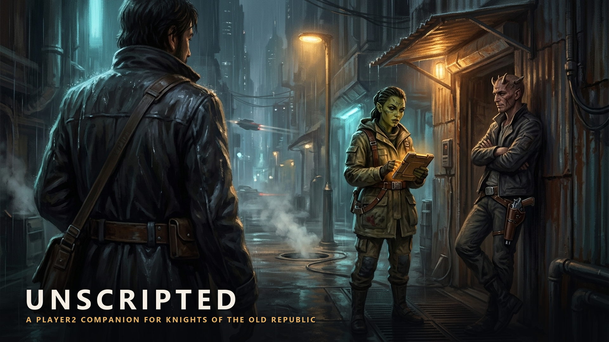

# 🌌 KotOR: UNSCRIPTED

### ⚡ *Knights of the Old Republic: Unscripted. A Player2 companion for Star Wars: Knights of the Old Republic. Nobody wrote their lines.* ⚡

---

## 🎤 LADIES AND GENTLEMEN, PLAYER TWO HAS ENTERED THE GALAXY

Four thousand years before the Empire, the Republic is burning. Darth Malak's fleet is tearing across the Outer Rim, the Jedi are scattered, and you just crawled out of the wreck of the Endar Spire with nothing but a blaster and a bad feeling.

You've been here before. Twenty-plus years of replays. You know every companion's banter, every betrayal, the exact dialogue node where they fall for you, because **every single line was written before you ever pressed New Game.**

**What if one of them hadn't read the script?**

**KotOR: Unscripted** puts a brand-new companion in your party, powered by **Player2**. They walk the same campaign you do, from the Undercity of Taris to the plains of Dantooine and beyond, make up their own mind about what they see, and **answer you in their own words.** They aren't following you around. They're travelling with you.

> 💬 **No dialogue trees. No canned lines. No fake spawns.**
> Your companion plays with a real body, a real purse, real gear and the same rules as everyone else in the galaxy. If the game won't allow it, they can't do it.

---

## 💥 WHAT MAKES THEM ALIVE

### 🧠 1. A Person, Not a Plot Device
* 🎭 **A personality all their own**, born the moment you meet. A cynical smuggler, a soldier who has buried too many friends, a dreamer who wants to see the Jedi enclave with their own eyes. Never the same companion twice.
* 🗣️ **Talk to them in your own words.** They talk back about where you are, what just happened, and what they really think of you.
* ⚖️ **Light side or dark, they're watching.** Spare the Sith deserter or cut him down, haggle the Twi'lek merchant or pay full price. They see what you do, and they'll tell you what they think of it.
* 📜 **They remember.** The promise you broke on Taris, the Sith ambush where you left them to bleed, the credits you still owe. It all stays on their record, and it shapes who they become.
* 🌱 **Wants of their own.** They find things to want in what happens on your playthrough, so their goals change every time you play. They'll ask for your help, or go after it themselves.
* 🌙 **A life between the scenes.** They keep thinking while you shop, rest and cross the galaxy.

### ⚔️ 2. A Real Partner on Every World
* 🛡️ **Fights at your side** with the engine's own combat brain, from cantina brawls to Sith patrols. They patch you and themselves up with medpacs and don't wait to be told.
* 🎒 **Loots, gears up and levels up.** They choose their own armour, blasters and blades, and their own build. Earn their trust and they may let you choose.
* 👀 **Sees what you see.** They notice what happens around them and have something to say about it.

### 👥 3. Two Companions, Two Minds
* 🧑‍🤝‍🧑 **Bring up to two companions at once**, each a different person with a different take on you, and on each other.
* ⚙️ **Each one keeps their own settings.** Tell them in conversation how much they may spend, whether they think in the background, and whether they touch your gear. One companion's choices never change the other's.

### 🎲 4. Play, Spar, Wager
* 🥋 **Challenge them to a duel.** They'll take it seriously.
* 🃏 **Sit down to pazaak.** They play their own side deck, can bluff, and stake only credits from their own purse.

### 🎛️ 5. Settings Inside the Game
* 🖥️ **Options → Companions**, right in the game's own menu. Set the daily joule budget, how often companions may think, and how much background thinking they do, without leaving the game.
* 🔋 **Thrifty by design.** The default stays under 200 joules a real day, and your own conversations always come first.

---

## 🛡️ THE GAME IS TRUTH

UNSCRIPTED runs on one rule: **the model decides, the game checks.**
* ✅ **Real bodies, real credits, real gear.** Nothing spawns from thin air. Every move goes through the game itself.
* ✅ **Any Player2 model.** Built to work with whichever model Player2 hands it.
* ✅ **Your friend's seat is safe.** The co-op engine underneath still lets a human friend take that seat, exactly as before.

---

## 🚧 STATUS: IN THE FORGE

UNSCRIPTED is **in active development** with **no public release yet.** Every feature above passes its checks in test games, and live play with Player2 continues. Watch this repository for the first release.

---

**🌌 The Republic needs heroes. Your companion hasn't decided yet whether you're one. ✨**

KotOR: Unscripted is an unofficial, non-commercial fan project built on KotOR Co-op and reone (GPL-3.0). It is not affiliated with, endorsed by or connected to Lucasfilm, Disney, BioWare, Aspyr or Electronic Arts. Star Wars, Knights of the Old Republic and related names are trademarks of their respective owners. You need your own copy of the game. The characters in the fan art are original.
